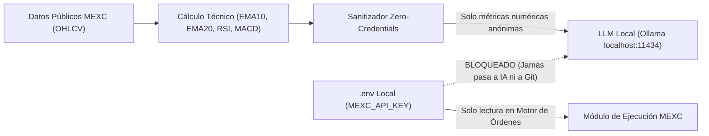

# 🤖 MEXC Trading Bot + Local LLM (`v0.1.0`)


-FF6F00?style=for-the-badge)


**Universidad Iberoamericana León | Ciencia de Datos aplicada a la Economía**  
**Entregable 3 — Corte `v0.1.0` (17 de noviembre de 2026)**  
**Autor:** Eduardo  

---

## 📌 1. Información de la Versión (`v0.1.0`)

Esta es la **versión `v0.1.0`** del **Bot de Trading Algorítmico asistido por un LLM Local**, diseñado para analizar series temporales en **MEXC** (Futuros Perpetuos USDT-M como `BTCUSDT`, `ETHUSDT`, `SOLUSDT`) y el catálogo histórico de **36 empresas bursátiles** almacenado en **SQLite**.

### Alcance de la versión `v0.1.0`:
- [x] **Interfaz de Usuario (UI) reactiva** construida con **Vue 3, Vite y TypeScript**.
- [x] **Conexión a datos de mercado de MEXC** y motor de indicadores técnicos en tiempo real:
  - Media Móvil Exponencial Rápida (**`EMA 10`**) y Lenta (**`EMA 20`** — estrategia *Golden Cross / Death Cross*).
  - Índice de Fuerza Relativa (**`RSI 14`**).
  - Convergencia/Divergencia de Medias Móviles (**`MACD 12, 26, 9`**).
- [x] **Consumo exclusivo de LLM Local (`Ollama` en `http://localhost:11434`)** para interpretación de señales técnicas sin enviar datos a servicios en la nube.
- [x] **Aislamiento estricto de credenciales (*Indispensable: No pasar API a I.A.*):** Las llaves de MEXC nunca se envían al prompt del LLM ni se suben al repositorio Git.
- [x] **Integración del Portafolio de 36 Empresas (`SQLite` + `yfinance`)** por sectores económicos.

---

## 🛠️ 2. Tecnologías Aplicadas

| Capa / Módulo | Tecnología Aplicada | Versión | Propósito en el Bot (`v0.1.0`) |
| :--- | :--- | :--- | :--- |
| **Lenguaje Frontend / Lógica** | **TypeScript** | `~5.6.0` | Tipado estático estricto para velas OHLCV, indicadores, órdenes y respuestas del LLM. |
| **Framework de Interfaz (UI)** | **Vue 3** (`<script setup>`) | `^3.5.0` | Dashboard reactivo de monitoreo de mercado, señales EMA/RSI/MACD y consola del Bot. |
| **Bundler y Entorno Dev** | **Vite** | `^5.4.0` | Servidor de desarrollo ultrarrápido y empaquetado optimizado. |
| **Motor de Inteligencia Artificial** | **LLM Local (Ollama API)** | Local (`11434`) | Consumo local de modelos (`llama3.2`, `qwen2.5`, `deepseek-r1`) vía `http://localhost:11434/api/generate`. |
| **Exchange / Mercado Objetivo** | **MEXC API (Futures / Spot)** | `v1 / v3` | Cotizaciones OHLCV en tiempo real (`BTCUSDT`, `ETHUSDT`, `SOLUSDT`) y simulación de órdenes `Long/Short` con `TP/SL`. |
| **Persistencia Histórica** | **SQLite + Python (`yfinance`)** | `3.x` | Base de datos relacional local (`mercado_portafolio.sqlite`) con histórico de 36 empresas en 6 sectores. |
| **Seguridad de Credenciales** | **Dotenv + `.gitignore` + Sanitizador** | `v0.1.0` | Bloqueo total de exposición de API Keys tanto hacia Git como hacia el contexto del LLM. |

---

## 🔒 3. Arquitectura de Seguridad: *No pasar API a I.A.*

Cumpliendo con el requisito indispensable del proyecto, el sistema implementa una **barrera de sanitización de doble capa** (`src/services/localLlmService.ts`):



1. **Aislamiento en Repositorio (`.gitignore`):** El archivo `.env` está excluido del control de versiones. Solo se incluye `.env.example` como plantilla sin valores reales.
2. **Aislamiento hacia la IA (`sanitizePayloadForLLM`):** Antes de construir cualquier prompt para el LLM local, el servicio filtra únicamente valores numéricos de mercado (`symbol`, `price`, `ema10`, `ema20`, `rsi14`, `macdHist`) y **verifica mediante expresiones regulares** que ninguna llave, token o firma criptográfica pueda incluirse en el texto enviado al modelo.
3. **Ejecución 100% Local:** El bot rechaza conexiones a endpoints de LLMs externos y solo permite `localhost` / `127.0.0.1`.

---

## 📂 4. Estructura del Proyecto

```text
BotTrading/
├── .env.example                 # Plantilla de variables de entorno (SIN llaves reales)
├── .gitignore                   # Bloqueo estricto de .env, llaves privadas y artefactos
├── index.html                   # Entrada principal de la aplicación Vite
├── package.json                 # Dependencias y scripts (Vue 3, Vite, TypeScript)
├── tsconfig.json                # Configuración de TypeScript
├── vite.config.ts               # Configuración de Vite y proxy local
├── README.md                    # Documentación de versión v0.1.0 y tecnologías
└── src/
    ├── main.ts                  # Inicialización de Vue 3
    ├── style.css                # Estilos del dashboard oscuro tipo terminal financiera
    ├── App.vue                  # Interfaz principal del Bot (MEXC + LLM Local + Portafolio 36)
    ├── types/
    │   └── trading.ts           # Interfaces TypeScript (Candle, TechnicalSignal, LlmAnalysis)
    ├── services/
    │   ├── mexcService.ts       # Cliente de mercado MEXC + cálculo de EMA10, EMA20, RSI y MACD
    │   └── localLlmService.ts   # Conector exclusivo a LLM Local (Ollama) con sanitizador
    └── data/
        └── portfolio30.ts       # Catálogo integrado de las 36 empresas (SQLite / yfinance)
```

---

## 🚀 5. Instalación y Ejecución Local

### Prerrequisitos
1. **Node.js** `>= 18.x`
2. **Ollama** (para el LLM Local) corriendo en `http://localhost:11434`:
   ```bash
   ollama run llama3.2
   ```

### Pasos para iniciar la UI (`Vue + Vite + TypeScript`)
```bash
# 1. Entrar a la carpeta del proyecto
cd BotTrading

# 2. Copiar la plantilla de variables de entorno (NO subir .env a Git)
cp .env.example .env

# 3. Instalar dependencias
npm install

# 4. Ejecutar el servidor de desarrollo Vite
npm run dev
```

---

## 📈 6. Estrategia Técnica Implementada (`v0.1.0`)

El bot evalúa automáticamente en cada actualización de vela:
1. **Cruce de Medias Exponenciales (`EMA 10` vs `EMA 20`):**
   - **Señal `LONG` (Golden Cross):** `EMA 10 > EMA 20` con precio de cierre por encima de ambas líneas.
   - **Señal `SHORT` (Death Cross):** `EMA 10 < EMA 20` con rechazo debajo de la `EMA 20`.
2. **Confirmación de Impulso (`MACD 12, 26, 9` y `RSI 14`):**
   - Evita entradas `LONG` en sobrecompra (`RSI > 70`) y entradas `SHORT` en sobreventa (`RSI < 30`).
3. **Gestión de Riesgo Automática (`TP / SL`):**
   - Calcula niveles sugeridos de **Take Profit (`TP`)** y **Stop Loss (`SL`)** basados en la distancia a la `EMA 20` y la volatilidad reciente antes de consultar la opinión del **LLM Local**.
